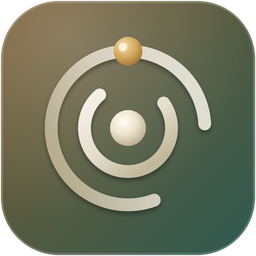

<p align="center">
  
</p>

<h1 align="center">NeoRouter</h1>

<p align="center"><strong>Every model. One endpoint.</strong></p>

<p align="center">
  Connect any inference provider, from free tiers to paid APIs and your own servers.<br>
  NeoRouter checks every key, imports every model and routes each request to the best one right now.
</p>

<p align="center">
  <a href="https://github.com/NeoLabs-Systems/NeoRouter/releases/latest"></a>
  <a href="LICENSE"></a>
  <a href="https://nodejs.org"></a>
  
</p>

<p align="center">
  <a href="https://discord.gg/f59rg2RwUT"></a>
</p>

<table>
  <tr>
    <td width="33%" valign="top">
      <h3>🔌 80+ providers</h3>
      Free tiers, paid APIs, aggregators,<br>
      local Ollama and any custom endpoint.
    </td>
    <td width="33%" valign="top">
      <h3>🧠 Learns as it routes</h3>
      <code>model: "auto"</code> picks by quality,<br>
      speed, reliability and price.
    </td>
    <td width="33%" valign="top">
      <h3>💸 Strictly free if you want</h3>
      Free-only keys never touch a paid model.<br>
      Budgets stop paid keys at the limit.
    </td>
  </tr>
</table>

---

## 🚀 Install

```bash
bash <(curl -fsSL https://raw.githubusercontent.com/NeoLabs-Systems/NeoRouter/main/install.sh)
```

or with npm:

```bash
npm i -g github:NeoLabs-Systems/NeoRouter && neorouter install
```

Then open **http://localhost:4600/app**. The first account you create becomes the administrator. Add a provider, create a router key, and point any OpenAI or Anthropic SDK at `http://localhost:4600/v1`.

```python
from openai import OpenAI

client = OpenAI(base_url="http://localhost:4600/v1", api_key="nrt_…")
client.chat.completions.create(model="auto:fast", messages=[{"role": "user", "content": "Hi"}])
```

```bash
ANTHROPIC_BASE_URL=http://localhost:4600 ANTHROPIC_AUTH_TOKEN=nrt_… claude
```

## ✨ What it does

<table>
  <tr>
    <td width="33%" valign="top"><b>🔑 Keys checked on the spot</b><br>Every key is validated, encrypted and its models imported automatically. OpenRouter connects with one click.</td>
    <td width="33%" valign="top"><b>🗂️ Live model catalog</b><br>Prices, context sizes and an intelligence estimate from public metadata, refreshed in the background.</td>
    <td width="33%" valign="top"><b>🧭 Auto router</b><br>Presets from <i>most reliable</i> to <i>smartest</i> and <i>cheapest</i>, or your own weights and limits.</td>
  </tr>
  <tr>
    <td valign="top"><b>🩹 Self-healing</b><br>Errors, rate limits and slow answers earn penalties and cooldowns. Hanging providers are hedged, failures fall back silently.</td>
    <td valign="top"><b>⚖️ Spreads the load</b><br>Bursts are distributed across models and queue briefly when every free tier is saturated.</td>
    <td valign="top"><b>📊 Quotas and analytics</b><br>Free-tier limits learned from headers and errors. Charts for traffic, latency, tokens, cost and providers.</td>
  </tr>
  <tr>
    <td valign="top"><b>🎟️ Router keys</b><br>Free-only, paid or both. USD budgets per day, month or total, RPM limits and model allow-lists.</td>
    <td valign="top"><b>🔀 Three APIs</b><br>OpenAI Chat Completions, Anthropic Messages and OpenAI Responses, with streaming, tools and vision.</td>
    <td valign="top"><b>👥 Multi-user</b><br>Provider keys stay private per account, with optional authenticator 2FA. Only request metadata is logged, never prompts.</td>
  </tr>
</table>

**Providers:** Groq, Google Gemini, Cerebras, Mistral, OpenRouter, NVIDIA NIM, Cloudflare, Cohere, Z.ai, SiliconFlow, Hugging Face, Ollama Cloud, Kilo, OpenAI, Anthropic, xAI, DeepSeek, Together, Fireworks, DeepInfra, Nous, local Ollama and LM Studio, and any OpenAI- or Anthropic-compatible endpoint.

## 📚 Docs

| Start | Understand | Extend |
| --- | --- | --- |
| [Configuration](docs/configuration.md) | [Routing](docs/routing.md) | [Providers](docs/providers.md) |
| [CLI](#-cli) | [Security](SECURITY.md) | [Contributing](CONTRIBUTING.md) |

## 🛠️ CLI

`neorouter install · start · stop · restart · status · doctor · logs · backup · update · env · reset-password · reset-2fa · providers import · rebuild-web · version`

## 🧪 Project status

- **Beta.** Expect breaking changes.
- **Help.** [Issues](https://github.com/NeoLabs-Systems/NeoRouter/issues) for bugs, [SECURITY.md](SECURITY.md) for vulnerabilities.

## 📄 License

[AGPL-3.0-only](LICENSE).

<p align="center"><sub>Made with ❤️ by <a href="https://github.com/neooriginal">Neo</a> · <a href="https://github.com/NeoLabs-Systems">NeoLabs Systems</a></sub></p>
