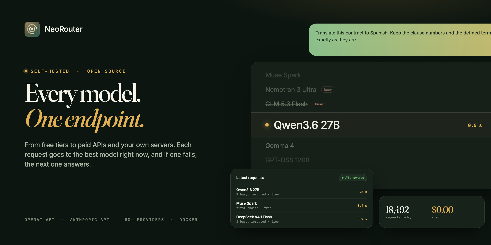
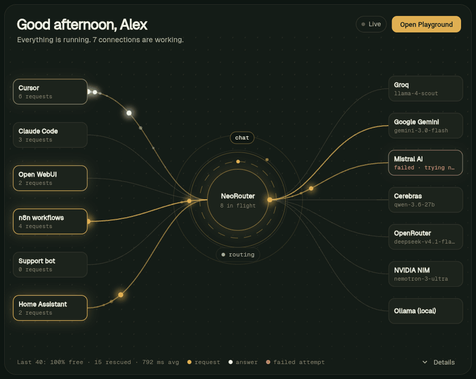

<p align="center">
  
</p>

<h1 align="center">NeoRouter</h1>

<p align="center"><strong>Every model. One endpoint.</strong></p>

<p align="center">
  Connect any inference provider, from free tiers to paid APIs and your own servers.<br>
  NeoRouter checks every key, imports every model and routes each request to the best one right now.
</p>

<p align="center">
  <a href="https://github.com/NeoLabs-Systems/NeoRouter/releases/latest"></a>
  <a href="https://github.com/NeoLabs-Systems/NeoRouter/actions/workflows/ci.yml"></a>
  <a href="LICENSE"></a>
  <a href="https://go.dev"></a>
  <a href="https://neolabs-systems.github.io/NeoRouter/api/"></a>
</p>

<p align="center">
  <a href="https://discord.gg/f59rg2RwUT"></a>
</p>

https://github.com/user-attachments/assets/f42be679-1e12-4cb1-9c00-d0f3c15bf403


<table>
  <tr>
    <td width="33%" valign="top">
      <h3>🔌 80+ providers</h3>
      Free tiers, paid APIs, aggregators,<br>
      local Ollama and any custom endpoint.
    </td>
    <td width="33%" valign="top">
      <h3>🧠 Learns as it routes</h3>
      <code>model: "auto"</code> picks by quality,<br>
      speed, reliability and price.
    </td>
    <td width="33%" valign="top">
      <h3>💸 Strictly free if you want</h3>
      Free-only keys never touch a paid model.<br>
      Budgets stop paid keys at the limit.
    </td>
  </tr>
</table>

---

## 🚀 Install

```bash
bash <(curl -fsSL https://raw.githubusercontent.com/NeoLabs-Systems/NeoRouter/main/install.sh)
```

For macOS and Linux (x64 and arm64). It downloads the `neorouter` binary from the latest release, checks it and sets up the background service; the web app comes inside the signed release, so there is nothing else to install. On Windows, download `neorouter-cli-windows-x64.exe` from the [latest release](https://github.com/NeoLabs-Systems/NeoRouter/releases/latest) and run it with `install`.

The installer follows the stable channel. For beta, prefix the command with `NEOROUTER_RELEASE_CHANNEL=beta`, or switch later with `neorouter channel beta`. On fish, wrap the command: `bash -c 'bash <(curl -fsSL https://raw.githubusercontent.com/NeoLabs-Systems/NeoRouter/main/install.sh)'`.

**Coming from the Node.js version?** Run `neorouter update`, or the installer again. Your data in `~/.neorouter` is backed up first and kept: accounts, router keys and provider keys carry over.

Then open **http://localhost:4600/app**. The first account you create becomes the administrator. Add a provider, create a router key, and point any OpenAI or Anthropic SDK at `http://localhost:4600/v1`.

```python
from openai import OpenAI

client = OpenAI(base_url="http://localhost:4600/v1", api_key="nrt_…")
client.chat.completions.create(model="auto:fast", messages=[{"role": "user", "content": "Hi"}])
```

```bash
ANTHROPIC_BASE_URL=http://localhost:4600 ANTHROPIC_AUTH_TOKEN=nrt_… claude
```

## ✨ What it does

<p align="center">
  
</p>

<table>
  <tr>
    <td width="33%" valign="top"><b>🔑 Keys checked on the spot</b><br>Every key is validated, encrypted and its models imported automatically. OpenRouter connects with one click.</td>
    <td width="33%" valign="top"><b>🗂️ Live model catalog</b><br>Prices, context sizes and an intelligence estimate from public metadata, refreshed in the background.</td>
    <td width="33%" valign="top"><b>🧭 Auto router</b><br>Presets from <i>most reliable</i> to <i>smartest</i> and <i>cheapest</i>, or your own weights and limits.</td>
  </tr>
  <tr>
    <td valign="top"><b>🩹 Self-healing</b><br>Errors, rate limits and slow answers earn penalties and cooldowns. Hanging providers are hedged, failures fall back silently.</td>
    <td valign="top"><b>⚖️ Spreads the load</b><br>Bursts are distributed across models and queue briefly when every free tier is saturated.</td>
    <td valign="top"><b>📊 Quotas and analytics</b><br>Free-tier limits learned from headers and errors. Charts for traffic, latency, tokens, cost and providers.</td>
  </tr>
  <tr>
    <td valign="top"><b>🎟️ Router keys</b><br>Free-only, paid or both. USD budgets per day, month or total, RPM limits and model allow-lists.</td>
    <td valign="top"><b>🔀 Three APIs</b><br>OpenAI Chat Completions, Anthropic Messages and OpenAI Responses, with streaming, tools and vision.</td>
    <td valign="top"><b>👥 Multi-user</b><br>Provider keys stay private per account, with passkeys, QR sign-in and optional authenticator 2FA. Only request metadata is logged, never prompts.</td>
  </tr>
  <tr>
    <td valign="top"><b>🛡️ Privacy shield</b><br>Emails, IBANs, cards, secrets, your own terms and (optionally AI-detected) names become placeholders; answers get the real values back.</td>
    <td valign="top"><b>🗜️ Prompt compression</b><br>Lossless, balanced or aggressive: minified JSON, trimmed tool output and masked old observations, never touching code or your latest message.</td>
    <td valign="top"><b>💸 Savings</b><br>See what free models saved you and how many tokens compression removed.</td>
  </tr>
  <tr>
    <td valign="top"><b>🧬 Embeddings</b><br><code>/v1/embeddings</code> across providers. "auto" pins each key to one model so vectors stay comparable.</td>
    <td valign="top"><b>🎨 Images, speech, video</b><br>Image generation, text to speech, transcription with subtitles and video jobs, all routed with fallback.</td>
    <td valign="top"><b>⚡ System One models</b><br>Fast guard models (Llama Guard, NemoGuard, gpt-oss-safeguard, Prompt Guard) behind one <code>/v1/moderations</code>.</td>
  </tr>
  <tr>
    <td valign="top"><b>🔎 Web search</b><br>Tavily, Exa, Linkup, Parallel, Firecrawl, Serper, Brave, Jina and your own SearXNG behind <code>/v1/search</code>, with fallback.</td>
    <td valign="top"><b>🌐 Search for any model</b><br>Turn on web search in OpenAI, OpenRouter, Responses or Anthropic style; NeoRouter runs the searches for whichever model answers.</td>
    <td valign="top"><b>🔑 Several keys per provider</b><br>Connect two Groq keys (or any provider twice) and NeoRouter spreads requests by allowance left and learned concurrency limits.</td>
  </tr>
</table>

**Subscriptions:** ChatGPT (Plus/Pro, through the Codex sign-in), Ollama Cloud Pro/Max, OpenCode Go, Synthetic, MiniMax M Plan and Kimi Code as prepaid plans: used first while the allowance lasts, then stopped or billed per use.

**Local models:** admins can run text, speech, transcription, embedding and safety models on the server itself; NeoRouter shows what fits the hardware, then downloads, runs and repairs them.

**Search engines:** Tavily, Exa, Linkup, Parallel, Firecrawl, Serper, Brave Search, Jina and self-hosted SearXNG.

**Providers:** Groq, Google Gemini, Deepgram, ElevenLabs, Cerebras, Mistral, OpenRouter, NVIDIA NIM, Cloudflare, Cohere, Z.ai, SiliconFlow, Hugging Face, Ollama Cloud, Kilo, OpenAI, Anthropic, xAI, DeepSeek, Together, Fireworks, DeepInfra, Nous, local Ollama and LM Studio, and any OpenAI- or Anthropic-compatible endpoint.

## 🐳 Docker

```bash
git clone --branch main https://github.com/NeoLabs-Systems/NeoRouter.git && cd NeoRouter
docker compose up -d --build
```

All state lives in one volume. Upgrading an older setup, ports, reverse proxies and published images: [docs/docker.md](docs/docker.md).

## 📚 Docs

| Start | Understand | Extend |
| --- | --- | --- |
| [Configuration](docs/configuration.md) | [Routing](docs/routing.md) | [Providers](docs/providers.md) |
| [Docker](docs/docker.md) | [Security](SECURITY.md) | [Contributing](CONTRIBUTING.md) |
| [CLI](#%EF%B8%8F-cli) | [Anonymous statistics](docs/analytics.md) | |

## 🛠️ CLI

`neorouter install · start · stop · restart · status · doctor · repair · logs · update · channel · backup [list] · restore · env · reset-password · reset-2fa · providers import · uninstall · version`

`neorouter update --check` and `--notes` show what is new without installing anything. `neorouter help --all` lists every command.

## 🧪 Project status

- **Beta.** Expect breaking changes.
- **Help.** [Issues](https://github.com/NeoLabs-Systems/NeoRouter/issues) for bugs, [SECURITY.md](SECURITY.md) for vulnerabilities.

## 📄 License

[AGPL-3.0-only](LICENSE).

<p align="center"><sub>Made with ❤️ by <a href="https://github.com/neooriginal">Neo</a> · <a href="https://github.com/NeoLabs-Systems">NeoLabs Systems</a></sub></p>
